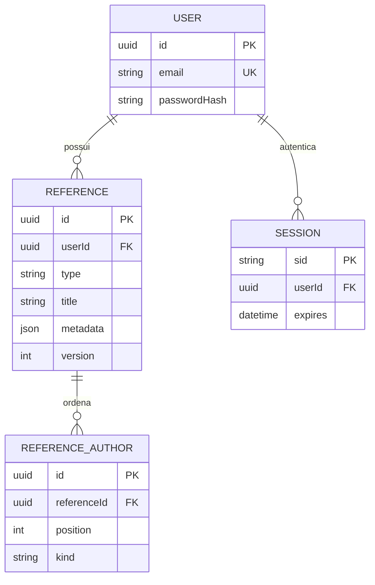

# Modelo de dados

## Estratégia

Usar MySQL com InnoDB, utf8mb4 e conexão configurada para UTC. Instantes de criação são UTC; datas bibliográficas sem horário são strings/DATE independentes de fuso. Não converter data de acesso em meia-noite UTC para depois exibir em outro fuso.

Separar usuário e referência; manter autores como itens próprios e ordenados, sem catálogo global de autores. Assim, editar “Ana Silva” em uma referência não muda outras. Campos específicos por tipo ficam em JSON validado pelo backend, com schemaVersion. Colunas de busca frequente ficam fora do JSON.



## Dicionário

| Tabela | Campos e restrições |
|---|---|
| users | id CHAR(36) PK; name VARCHAR(120) NOT NULL; email VARCHAR(254) UNIQUE NOT NULL, normalizado com trim e lowercase; passwordHash VARCHAR(255) NOT NULL; createdAt/updatedAt DATETIME(3) |
| bibliography_references | id CHAR(36) PK; userId CHAR(36) FK NOT NULL; type VARCHAR(32); title VARCHAR(1000); metadata JSON; authorship VARCHAR(20); plainText TEXT; segments JSON; warnings JSON; standardVersion VARCHAR(30); formatterVersion VARCHAR(30); institutionalProfile VARCHAR(40) NULL; schemaVersion INT; version INT padrão 1; idempotencyKey CHAR(36); requestHash CHAR(64); createdAt/updatedAt DATETIME(3) |
| reference_authors | id CHAR(36) PK; referenceId CHAR(36) FK NOT NULL; position INT NOT NULL; kind VARCHAR(20); givenNames VARCHAR(200) NULL; familyName VARCHAR(200) NULL; institutionName VARCHAR(500) NULL |
| sessions | sid VARCHAR(255) PK; userId CHAR(36) FK NULL; expires DATETIME; data TEXT. Adaptar model ao contrato do store de sessões e extrair userId da sessão; não criar outra tabela concorrente |

Campos de referência são obrigatórios salvo indicação contrária. `institutionalProfile = null` significa que só o perfil ABNT está sendo aplicado. Valores de type: book, journalArticle, webPage, academicWork. `authorship`: known ou unknown. Validar enum tanto na aplicação quanto nas migrations com restrições compatíveis.

`metadata` guarda somente campos específicos: subtítulo, publicação, acesso, periódico, grau etc. Não duplicar título e autores no JSON. A saída da API reconstitui o objeto completo. `schemaVersion` controla o formato desses dados; `formatterVersion` controla o algoritmo; `standardVersion` identifica a norma. São conceitos diferentes.

## Integridade

- UNIQUE(userId, idempotencyKey) evita duplicação de um salvamento repetido. A chave se mantém durante novas tentativas da mesma ação; um novo salvamento usa outra chave. requestHash identifica o conteúdo original: mesma chave com conteúdo diferente retorna 409.
- UNIQUE(referenceId, position) preserva posições sem repetição. Exigir posições contíguas no service.
- Autor pessoal exige givenNames e familyName; institucional exige institutionName; atributos incompatíveis ficam nulos. Autoria desconhecida exige zero autores.
- FK referência → usuário com ON DELETE CASCADE; FK autor → referência com ON DELETE CASCADE. Exclusão de conta não faz parte da interface inicial, mas deve existir procedimento operacional documentado antes do uso público.
- FK sessão → usuário com ON DELETE CASCADE quando vinculada; sessões anônimas podem ter userId nulo.
- Índice (userId, createdAt, id) para histórico; (userId, type, createdAt) para filtro. Busca inicial por título pode usar LIKE parametrizado; avaliar índice textual só com volume real.
- Listagem ordenada por createdAt DESC e id DESC para desempate. page começa em 1; pageSize padrão 20, máximo 100.

## Transações e concorrência

Salvar referência e autores na mesma transação. A prévia não abre transação e não grava no banco.

Editar com `UPDATE ... WHERE id = ? AND userId = ? AND version = ?`, incrementando version. Se nenhuma linha mudar, verificar a existência no escopo do usuário para diferenciar 404 de 409. Atualização dos autores e resultado participa da mesma transação. Não permitir atualização parcial em que texto corresponda a dados antigos.

Na repetição de POST, consultar o registro pela chave do usuário antes de reformatar: uma atualização do motor não deve mudar o retorno de uma operação já concluída. Se houver corrida de inserção, tratar a restrição UNIQUE e retornar o registro existente com conteúdo equivalente.

## ORM e migrations

Model descreve a tabela para o código; migration registra como criá-la ou alterá-la. Mudança em model não é migration automática. Usar arquivos numerados e versionados, revisar SQL e testar upgrade/rollback em banco de desenvolvimento.

Ordem inicial: users; bibliography_references; reference_authors; sessions e seus índices. Configuração do store não deve executar sync automático em produção. Não usar `sync({ force: true })` ou `sync({ alter: true })` em dados reais.

Se o backend usar ES Modules, manter arquivos do sequelize-cli em um escopo CommonJS explícito (package.json local com type commonjs) ou escolher uma configuração documentada compatível. Evitar misturar require e import no mesmo escopo sem decisão.

## Exemplo de metadata de livro

```json
{
  "subtitle": null,
  "edition": "2",
  "publicationPlace": "Fortaleza",
  "publisher": "Editora Exemplo",
  "publicationDate": { "literal": "2025", "kind": "exact" },
  "online": false
}
```

Os dados são fictícios. Campos bibliográficos como ano aproximado precisam de representação explícita; não colocar tudo em um INTEGER year nem usar ano atual como preenchimento automático.
