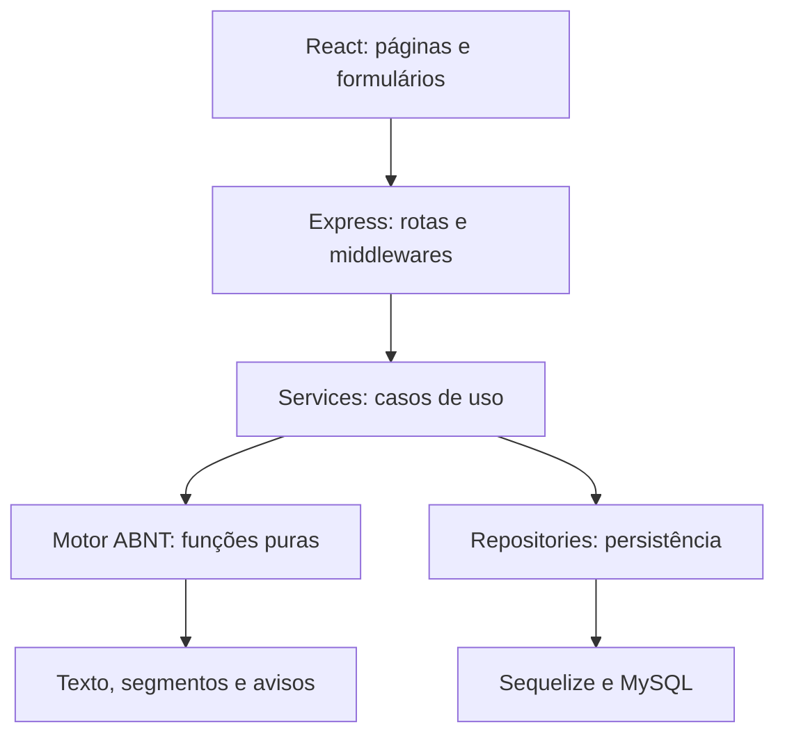

# Documentação técnica do projeto

## 1. Problema e objetivo

Estudantes precisam converter os dados de uma fonte em uma referência acadêmica sem montar manualmente pontuação, ordem dos elementos e destaques. O sistema receberá dados estruturados, validará sua consistência e aplicará regras bibliográficas versionadas. O objetivo é reduzir o trabalho de formatação e facilitar a revisão pelo usuário.

A ferramenta não confirma que uma obra existe nem que os dados digitados são verdadeiros. Ela formata informações fornecidas. Evitar a promessa de “eliminar todos os erros”: qualidade bibliográfica também depende da entrada e da revisão das regras.

O público previsto no slide inclui estudantes, professores e pesquisadores da Unifor. Trata-se de um projeto acadêmico voltado à instituição, sem confirmação de adoção institucional. O manual específico da Unifor não foi fornecido; conformidade institucional permanece pendente de validação.

## 2. O que foi extraído dos anexos

| Evidência | Consequência no projeto |
|---|---|
| Slide 6: cadastro, login, tipos de fontes, geração, cópia e histórico | Núcleo funcional do MVP |
| Slide 7: selecionar fonte, preencher e gerar em menos de 2 minutos | Fluxo curto e meta de teste de usabilidade |
| Slide 8: React, Node.js e MySQL | Restrições tecnológicas respeitadas |
| Slide 1 menciona citações e referências | Separar os dois produtos e confirmar prioridade das citações |
| ZIP contém NBR 6023:2025 e 2018; NBR 10520:2023 e 2002; guias | Propor 6023:2025 para referências e 10520:2023 para futura funcionalidade de citações |

A lista de tipos do slide é aberta. Para torná-la executável, propõe-se livro completo, artigo de periódico, página web e trabalho acadêmico (TCC, dissertação e tese). Capítulo de livro, legislação, vídeo, evento e demais fontes ficam para incrementos posteriores.

## 3. Escopo proposto

**MVP:** geração pública sem cadastro; quatro famílias de documentos; validação por tipo; visualização e cópia; cadastro, login e logout; salvamento explícito para usuário autenticado; histórico privado com consulta, edição e exclusão; identificação da versão normativa.

A geração pública e o botão “Salvar” são decisões propostas, não exigências explícitas do slide. O histórico é uma biblioteca das referências salvas, não um registro de cada clique em Gerar. Isso evita acumular tentativas incompletas e torna a persistência previsível.

**Depois do MVP:** citações no texto, coleções por trabalho, exportação DOCX/PDF/BibTeX, busca de metadados por DOI/ISBN, recuperação de senha por e-mail, login institucional e compartilhamento. Se o professor considerar citações obrigatórias, incluí-las formalmente no escopo e reestimar o cronograma antes de programar.

## 4. Stack recomendada

| Tecnologia | Função no projeto | Motivo da escolha |
|---|---|---|
| JavaScript moderno | Linguagem de backend e frontend | Atende à obrigação e evita dois processos de compilação |
| Node.js 24 LTS | Executar JavaScript no servidor | Linha LTS proposta; fixar atualização de segurança na implementação |
| Express 5 | Rotas HTTP e middlewares | API pequena e explícita, adequada ao aprendizado |
| React | Componentes e estado da interface | Obrigatório; permite reutilizar campos e telas |
| Vite | Desenvolvimento e build do frontend | Setup direto para uma SPA React |
| React Router | Navegação entre páginas | URLs para gerador, login e histórico |
| React Hook Form | Estado de formulários e lista de autores | Evita repetir controle de campos e mensagens |
| Zod 4 e @hookform/resolvers | Validar entradas | Schemas também funcionam com JavaScript; servidor sempre valida novamente |
| CSS Modules | Estilos por componente | Poucas dependências e CSS acessível para o grupo |
| fetch nativo | Comunicação HTTP | Suficiente para a API; centralizar tratamento de erros |
| Sequelize 6 | ORM e relações | API JavaScript direta, suporte a MySQL e transações |
| mysql2 | Driver do banco | Faz a conexão usada pelo Sequelize |
| sequelize-cli 6 | Migrations | Histórico explícito de alterações do schema |
| MySQL 8.4 | Persistência relacional | Base proposta da linha 8; validar disponibilidade no ambiente de hospedagem |
| express-session + connect-session-sequelize | Sessão persistida no MySQL | Logout e revogação simples, sem tokens em localStorage |
| argon2 | Hash de senhas | Usar Argon2id e verificar parâmetros na implementação |
| helmet e express-rate-limit | Cabeçalhos e limitação de tentativas | Controles básicos do serviço HTTP |
| Vitest, Testing Library e Supertest | Testes de regras, UI e API | Cobrem os riscos concretos do sistema |
| ESLint e Prettier | Consistência do código | Facilita revisão entre integrantes |

As versões exatas e compatibilidades das dependências devem ser registradas em package-lock.json após instalação e teste conjunto. Esta proposta não afirma que um conjunto de pacotes foi instalado e homologado. Não usar `latest` em produção sem revisão.

### Por que Sequelize como ORM?

ORM é uma biblioteca que mapeia tabelas e registros para operações no código. Por exemplo, `Reference.findAll({ where: { userId } })` consulta referências de um usuário. O driver mysql2 transporta a consulta; o MySQL armazena os dados. ORM não substitui modelagem, índices ou autorização.

| Opção | Benefícios para a equipe | Custo/atenção | Decisão |
|---|---|---|---|
| Sequelize | Models e migrations em JavaScript; relações explícitas | Manter models e migrations sincronizados | Recomendado para a restrição JS |
| Prisma | Schema declarativo, cliente gerado e ferramentas de migração | Setup e geração do cliente dependem da versão; conferir caminho para JS puro | Alternativa válida se o grupo priorizar sua experiência prévia |
| SQL com mysql2 | Controle direto das consultas | Mais código de mapeamento e migração | Útil para consultas específicas; não é ORM |

Não há necessidade de NestJS, microserviços, Redis, GraphQL, Redux ou filas neste escopo. Poderiam resolver problemas futuros, mas acrescentariam responsabilidades sem benefício claro agora. Context será usado apenas para o estado de sessão; estado do formulário fica no formulário.

## 5. Arquitetura

Um **monólito modular** é um único backend dividido por responsabilidades. Auth, referências e formatação pertencem ao mesmo processo e ao mesmo deploy. Frontend e backend ficam no mesmo repositório, mas são aplicações separadas.

| Camada | Responsabilidade | Exemplo |
|---|---|---|
| Route | Associar URL, método e middlewares | POST /api/v1/references |
| Middleware | Sessão, CSRF, limite e validação transversal | Bloquear salvamento sem login |
| Controller | Traduzir HTTP para uma chamada de serviço | Ler body validado e responder 201 |
| Service | Executar um caso de uso | Gerar e salvar referência do usuário |
| Formatter | Aplicar regras bibliográficas | Montar referência de livro |
| Repository | Consultar e persistir dados com escopo do usuário | Buscar por id e userId |
| Model | Descrever atributos e relações do ORM | Reference pertence a User |

**Regra de dependência:** o motor não importa Express, React ou Sequelize. Recebe dados e retorna resultado. O service pode coordenar o motor e o repository. O controller não monta strings bibliográficas nem executa consultas diretamente.

### Padrões usados, com propósito

- **Service Layer:** reúne os passos de um caso de uso, como validar dados, gerar resultado e persistir.
- **Repository:** mantém consultas e filtros de propriedade em um lugar. Implementar métodos pequenos e específicos; evitar um repositório genérico complexo.
- **Strategy:** cada tipo tem uma função de formatação com o mesmo contrato. Um mapa seleciona `book`, `journalArticle`, `webPage` ou `academicWork`. Não é necessário criar uma hierarquia de classes.
- **Injeção de dependência simples:** passar repository e formatter como parâmetros ao construir o service. Testes podem substituir o banco por um objeto controlado; não é necessário framework de injeção.
- **Alta coesão e baixo acoplamento:** cada módulo trata de uma responsabilidade e conhece poucos detalhes dos demais. Esses princípios também se relacionam ao GRASP.

Observer/event bus não é necessário: React já atualiza a interface a partir do estado. Não adicionar padrões apenas para aumentar a lista de nomes na apresentação.

## 6. Estrutura a implementar

| Caminho | Conteúdo planejado |
|---|---|
| frontend/src/app/ | Router, providers e inicialização |
| frontend/src/pages/ | GeneratorPage, LoginPage, RegisterPage e HistoryPage |
| frontend/src/features/references/ | ReferenceForm, AuthorFields, ReferencePreview e campos por tipo |
| frontend/src/features/auth/ | Formulários e estado de autenticação |
| frontend/src/components/ | Button, Input, Alert e Dialog reutilizáveis |
| frontend/src/services/ | Cliente fetch com credenciais e erros normalizados |
| frontend/src/styles/ | Estilos globais e tokens visuais |
| backend/src/app.js | Configurar Express sem abrir a porta |
| backend/src/server.js | Validar ambiente, conectar banco e iniciar servidor |
| backend/src/modules/auth/ | Routes, controller, service e repository de autenticação |
| backend/src/modules/references/ | Routes, controller, service e repository de referências |
| backend/src/domain/formatters/ | Registry e formatadores por tipo |
| backend/src/domain/rules/ | Autores, datas, pontuação, títulos e perfis normativos |
| backend/src/middlewares/ | Autenticação, CSRF, limite e erros |
| backend/src/database/models/ | Models e associações |
| backend/src/database/migrations/ | Evolução do schema |
| backend/src/config/ | Ambiente, sessão e conexão |
| backend/tests/ | Unitários e integração |
| shared/schemas/ | Schemas de entrada sem segredos ou dependências de servidor |
| documentacao/ | Contratos, requisitos e decisões |

O pacote cria esses diretórios, mas arquivos de implementação ainda precisam ser escritos. Inicialmente os schemas podem ser publicados como workspace local privado. Não importar pastas do backend no frontend: isso pode levar segredos e dependências de servidor ao navegador.

## 7. Fluxo completo: livro

1. O estudante abre o gerador e escolhe “Livro”.
2. React mostra autores, título, subtítulo, edição, cidade, editora, data e opção de acesso online.
3. O formulário valida os campos e mantém os dados em caso de erro.
4. O frontend envia JSON para POST /api/v1/references/preview.
5. Express limita o tamanho do body e valida o schema do tipo.
6. O service seleciona o perfil normativo e a estratégia de livro.
7. O motor retorna texto simples, segmentos com destaque, avisos e versões.
8. React renderiza os segmentos com elementos seguros e habilita a cópia.
9. Para salvar, o usuário entra na conta. O rascunho permanece apenas em memória durante o fluxo.
10. POST /references envia os dados originais. O servidor gera novamente o resultado e salva tudo em transação, vinculando ao usuário da sessão.
11. O histórico exibe as referências salvas. Edição gera novo resultado e atualiza a versão do registro; exclusão pede confirmação na interface.

A referência enviada pelo navegador nunca é aceita como resultado oficial. Texto e identificação normativa são produzidos pelo servidor. Em falha de salvamento, manter a prévia e mostrar “Não foi possível salvar”; não anunciar sucesso.

## 8. Decisões de interface

Telas: gerador público, cadastro, login, histórico e edição. O gerador deve ter seleção de tipo, campos agrupados, autores reordenáveis, ajuda contextual e prévia. No histórico, busca por título, filtro por tipo e paginação de 20 itens.

Estados necessários: inicial, carregando, sucesso, vazio, erro de validação, erro de rede e sessão expirada. Desabilitar envio enquanto uma requisição está em andamento e anunciar sucesso/erro por região acessível. Associar label e erro a cada input; permitir navegação por teclado.

Não usar o sobrenome deduzido automaticamente a partir do último espaço: nomes compostos e instituições tornam isso incorreto. Pedir nome e sobrenome de entrada separadamente, com ajuda e possibilidade de revisão.

## 9. Limites e validação

Conformidade só pode ser declarada para os tipos e casos homologados. Manter uma matriz de exemplos conferidos com docente ou bibliotecário, identificando seção da norma, entrada e saída esperada. O MORE serve como referência de experiência de uso; não é API do projeto nem oráculo de conformidade para uma edição diferente da norma.

A documentação detalhada de banco, API, requisitos, testes e implementação está nos demais arquivos desta pasta.
